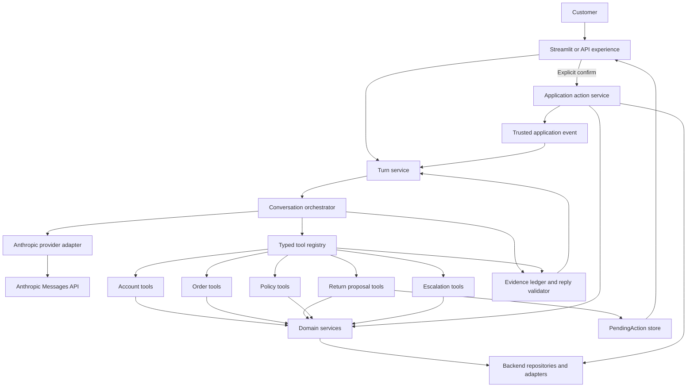
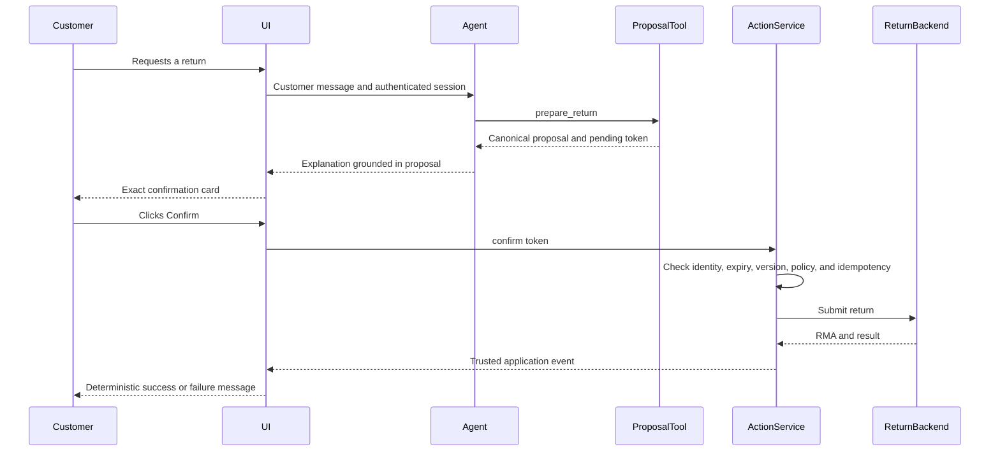

# Dewey Master Architecture

Last updated: 2026-10-25  
Status: target design for the combined Bookly agent

## 1. Executive summary

The master version will use v2 as its structural foundation and import the original
version's strongest safety boundary.

- **Keep from v2:** typed session state, customer verification, ownership-scoped order
  access, domain-separated tools, pure policy code, refund calculations, policy search,
  human escalation, Markdown playbooks, strict stop-reason handling, turn rollback,
  dependency injection, and structured traces.
- **Keep from the original:** customer-impacting actions are committed by the application,
  not by the language model. The model may prepare a canonical proposal, but only an
  explicit Confirm button can authorize submission. Confirmation revalidates the proposal
  immediately before the write.
- **Add:** a deterministic evidence validator between draft generation and delivery. It
  checks that sensitive facts and action claims in Dewey's reply are supported by trusted
  tool or application-event outputs.
- **Provider:** continue with the Anthropic Messages API. It is already integrated with the
  broader v2 design and covered by deterministic loop tests. Keep Anthropic-specific
  translation behind a small boundary, but do not build a second provider implementation
  until there is a concrete need.

The resulting principle is:

> The model may interpret, explain, and propose. Only trusted application code may know,
> authorize, or commit.

## 2. Why combine the versions

The two implementations optimize for different things.

The original version is deliberately narrow. Its three model-visible tools can retrieve an
order, check one item's eligibility, and prepare a return. `create_return` is not a model
tool. Streamlit renders the proposal from application state, and a button calls
`create_return` directly. This creates a clear, auditable authorization boundary and is
tested through the real UI.

v2 is a broader support system. It adds customer verification, ownership-scoped order
access, multiple order types, refund and replacement choices, policy retrieval, human
handoff, typed state, prompt playbooks, failure rollback, and richer tracing. Its module
layout will scale better as Bookly gains more support capabilities.

Neither version should be copied wholesale:

- The original does not authenticate customers and becomes difficult to extend if more
  domains are added to its shared modules and dictionaries.
- v2 exposes `submit_return` to the model. Its turn-index check proves that another customer
  message occurred, but it does not prove that the message authorized the exact items,
  amount, resolution, and consequences being submitted.

The master version therefore uses v2's package structure and support capabilities, while
moving consequential writes outside the model-visible tool surface.

## 3. Goals

1. Preserve Dewey's conversational strengths: intent understanding, concise explanations,
   useful clarification, and a warm Bookly voice.
2. Make identity, ownership, eligibility, money, authorization, and writes deterministic.
3. Require explicit customer authorization for every consequential action.
4. Ensure every sensitive fact in a final reply is traceable to trusted evidence.
5. Keep the architecture understandable without an agent framework.
6. Support deterministic unit, integration, orchestration, and UI tests without an API key.
7. Provide enough structured telemetry to debug failures without exposing customer data.
8. Allow the mock backend and Streamlit UI to be replaced without redesigning the domain.

## 4. Non-goals for the first master version

- Multi-agent routing
- Supporting both Anthropic and OpenAI at runtime
- Embeddings or a vector database
- Long-term conversational memory
- Autonomous policy exceptions
- Voice input or output
- A production CRM, order-management system, or returns provider
- A custom web frontend
- Letting free-form chat text directly authorize a write

These can be revisited after the action and grounding guarantees are measured.

## 5. Design principles

### 5.1 Authority is explicit

Each kind of decision has one owner:

| Concern | Owner | Rule |
|---|---|---|
| Intent, wording, tone, and clarification | LLM | May interpret and propose; never establishes business truth |
| Signed-in identity | Application session | Never accepted from model-generated tool arguments |
| Record ownership | Domain service/repository | Every customer-specific lookup is scoped to the authenticated principal |
| Eligibility and money | Policy code | Pure, deterministic, and tested; money is represented as integer cents |
| Proposed action | Workflow service | Stored as an immutable, versioned `PendingAction` |
| Customer authorization | Application UI/API | Explicit control bound to one `PendingAction` token |
| Consequential write | Backend action service | Reauthorizes, revalidates, and executes idempotently |
| Final-reply facts | Evidence validator | Sensitive claims must match trusted evidence |
| Failure and handoff | Orchestrator | Partial output is never shown; recovery behavior is deterministic |

### 5.2 The model never supplies trusted identity

The authenticated customer ID comes from the application session. Model-visible tools may
accept an order ID or item ID, but repository queries always include the session customer
scope. Another customer's order must look the same as a nonexistent order.

For the demo, email and ZIP verification may continue to establish the session principal.
Once verification succeeds, it is locked for that conversation. A later tool call cannot
replace the verified customer. Production will use a signed-in session instead.

### 5.3 Policy and money have one executable source of truth

`policy.py` decides eligibility, permitted resolutions, fees, refund values, and timing
identifiers. Monetary values use cents, not floating-point dollars.

Customer-readable policy documentation may be generated from structured policy data or
checked against it in tests. Policy values must not silently diverge between `config.py`,
`policy.py`, and `data/policies.md`.

### 5.4 Prepare and commit are different capabilities

The model may call read-only tools and proposal tools. It may not call commit functions.

A proposal captures authoritative details for review. A commit is an application action
that requires explicit authorization, current ownership, current policy eligibility,
freshness, and an idempotency key.

### 5.5 Visible history is canonical

The customer-visible transcript, provider message history, trusted application events, and
trace reference the same turn records. The system must not maintain two unrelated versions
of what the customer and model believe was said.

If a provider call fails, the incomplete attempt is marked as superseded in diagnostics and
does not become active conversation history. If an action succeeds despite a later model
failure, the trusted action event remains authoritative.

## 6. Target architecture



### 6.1 Proposed module layout

```text
bookly/
  config.py                  # non-secret settings and limits
  models.py                  # shared immutable and session data shapes
  prompt.py                  # assembles Markdown playbooks
  prompts/
    base.md
    dewey.md
    order_status.md
    returns.md
    general.md

  orchestration/
    agent.py                 # bounded LLM/tool loop
    provider.py              # narrow Anthropic request/response translation
    turns.py                 # canonical turn commit, rollback, and application events

  domain/
    policy.py                # pure eligibility and pricing in cents
    orders.py                # ownership-scoped order operations
    returns.py               # proposal validation and return execution
    escalation.py            # ticket behavior

  tools/
    registry.py              # schemas, authorization tiers, dispatch
    account.py
    orders.py
    returns.py               # prepare only; no model-visible submit tool
    support.py

  actions/
    returns.py               # UI-authorized confirm/cancel path

  validation/
    evidence.py              # evidence ledger and deterministic fact checks
    replies.py               # validate, repair once, or return safe fallback

  repositories/
    protocols.py             # customer, order, return, policy, and ticket interfaces
    mock.py                  # JSON/Markdown demo adapters

  observability/
    trace.py                 # structured redacted events
```

The exact number of files may remain smaller while the prototype is compact. The important
constraint is dependency direction:

```text
experience -> orchestration -> tools -> domain -> repositories
                           \-> validation
experience -> actions -> domain -> repositories
```

Domain code never imports Streamlit, Anthropic, prompt text, or UI state.

## 7. Core data shapes

### 7.1 SessionState

The existing v2 `SessionState` remains the base, with these changes:

- verified identity is immutable after successful verification
- money is stored in cents
- message history is represented through canonical turns
- pending actions replace model-submittable quotes
- evidence is associated with the turn that produced it
- trace events can be active, superseded, or redacted

Conceptually:

```python
@dataclass
class SessionState:
    turn_index: int
    verified_customer_id: str | None
    verified_first_name: str | None
    verify_attempts: int
    turns: list[Turn]
    pending_actions: dict[str, PendingAction]
    escalation: Escalation | None
    trace: list[TraceEvent]
```

### 7.2 PendingAction

`PendingAction` is application-managed state. It is not copied from model prose.

```python
@dataclass(frozen=True)
class PendingAction:
    token: str
    kind: Literal["submit_return"]
    customer_id: str
    payload: ReturnProposal
    policy_version: str
    resource_version: str
    created_turn: int
    expires_at: datetime
    idempotency_key: str
```

The payload contains canonical order, item, title, reason, resolution, amount in cents,
fees in cents, label type, and timing. The UI renders this object directly.

Changing an item, reason, resolution, or amount creates a new pending action and invalidates
the old one. A new unrelated chat message may also expire the displayed proposal, following
the original version's stale-proposal protection.

### 7.3 Turn and evidence records

A canonical `Turn` links:

- the customer message
- provider calls and tool requests
- trusted tool results
- a draft reply
- validation findings
- the exact final reply shown to the customer
- trusted application events

The `EvidenceLedger` contains normalized facts from trusted outputs, including:

- order, item, quote, return, RMA, tracking, and ticket identifiers
- dates and delivery estimates
- currency amounts in cents
- status and eligibility results
- successful action-event types
- permitted next-step statements

Model-generated text is never evidence.

## 8. Tool model

### 8.1 Tool tiers

Every registry entry declares an authorization tier:

| Tier | Meaning | Examples |
|---|---|---|
| `public_read` | No customer record access | `search_policies` |
| `session_write` | Changes only the current support session | `verify_customer`, `escalate_to_human` |
| `customer_read` | Reads records owned by the verified customer | `list_orders`, `get_order` |
| `proposal` | Computes and stores a non-binding action proposal | `prepare_return` |
| `commit` | Changes a customer or backend record | Never model-visible |

The model receives schemas only for the first four tiers. `commit` functions are absent from
the provider tool list and rejected by the model dispatch path.

### 8.2 Tool results

Retain v2's result contract:

```python
{
    "ok": False,
    "error_code": "NOT_VERIFIED",
    "message": "I need to verify your account before I can look at orders.",
    "hint": "Ask for the account email and ZIP code together."
}
```

- `message` is safe to paraphrase to the customer.
- `hint` is model guidance and must not be presented as a business fact.
- internal exceptions are logged with redaction and are not included in customer-visible
  traces.
- successful results contain structured facts that can be added to the evidence ledger.

### 8.3 Parallel tool calls

Parallel read-only calls may run together when they do not depend on one another. Session
writes and proposal creation run in a deterministic order. Tool results are returned to the
model in one provider message, preserving v2's tested behavior.

## 9. Customer-authorized action flow

The return flow combines v2's pricing and item support with the original's UI boundary.



Rules:

1. `prepare_return` performs no backend write.
2. `submit_return` is removed from the model-visible registry.
3. Typing “yes,” “confirm,” or any equivalent chat message cannot commit.
4. The confirmation card displays exact canonical details, not a model summary.
5. Confirm is bound to one opaque pending-action token.
6. Commit rechecks customer ownership, action expiry, resource version, policy version,
   current eligibility, and prior execution.
7. The idempotency key prevents duplicate returns if the UI or network retries.
8. Cancel and expiry create trusted events and make the token unusable.
9. Only a successful application event establishes that a return was submitted.
10. Customer-facing confirmation is produced deterministically from the action result. A
    later model turn may discuss it, but cannot invent or alter it.

## 10. Conversation lifecycle

For each customer message:

1. Validate input length and session state.
2. Increment the turn index and create a turn checkpoint.
3. Add the customer message to the canonical turn.
4. Assemble the system prompt, relevant history, tool schemas, and trusted application
   events.
5. Call Anthropic through the provider boundary.
6. On `tool_use`, dispatch permitted tools, record redacted trace events, and add successful
   structured outputs to the evidence ledger.
7. Repeat until `end_turn`, subject to the configured step limit.
8. Extract the draft text.
9. Validate the draft against evidence.
10. If valid, commit the exact reply to the canonical transcript.
11. If invalid, attempt one constrained repair with tools disabled and the validation
    findings supplied.
12. Validate the repair. If it still fails, commit a fixed safe fallback and offer or create
    a handoff as appropriate.

`max_tokens`, refusal, an empty answer, an unexpected stop reason, or the step limit never
exposes partial model output. Use v2's safe handoff behavior.

On provider failure, active conversation history rolls back to the checkpoint. Trace events
from the failed attempt are retained only as redacted, superseded diagnostics. Real tool or
application side effects remain represented by trusted events.

## 11. TODO next: final-reply evidence validation

> Neither implementation validates the final natural-language reply against tool evidence.
> Python protects actions, but the model can still misstate a date, amount, identifier, or
> outcome. This is the highest-value missing safety layer.

This is the first major capability to add after unifying the action boundary.

### 11.1 Deterministic checks first

The initial validator extracts sensitive tokens and claims from the draft:

- currency amounts
- dates and delivery estimates
- order, item, quote, tracking, RMA, return, and ticket identifiers
- statuses and eligibility claims
- action claims such as “submitted,” “refunded,” “cancelled,” “emailed,” or “escalated”

Every extracted fact must match the current turn's evidence or an active trusted session
fact. Action claims require a matching successful tool or application event. Examples:

- “I submitted your return” requires a successful `submit_return` application event.
- “I escalated this” requires a successful ticket result.
- “Your refund is $22.01” requires that exact amount in the authoritative proposal or
  action result.
- “It will arrive October 28” requires that date and the appropriate estimated-delivery
  field from an order lookup.

The validator should normalize harmless formatting differences, such as `$22.01` versus
`2201` cents and `2026-10-28` versus “October 28, 2026.”

### 11.2 Repair and fallback

If validation fails:

1. Record structured violation codes in the trace.
2. Make one repair call with tools disabled.
3. Supply only the draft, violations, and trusted evidence required for correction.
4. Validate the repaired text again.
5. If it still fails, replace it with a fixed response that does not repeat untrusted facts
   and offers a retry or human handoff.

The canonical transcript stores only the text actually shown to the customer. Rejected
drafts remain redacted diagnostics, not conversational history.

### 11.3 Why not start with an LLM judge

An LLM validator can detect nuanced semantic contradictions, but it adds latency, cost, and
another probabilistic failure mode. Deterministic checks cover Bookly's highest-risk facts
and are easy to regression test.

After measuring deterministic false positives and missed errors, an LLM check may be added
for softer claims. It must not replace hard evidence gates.

## 12. Anthropic API decision

The master version will continue using the Anthropic Messages API.

Reasons:

1. v2 contains most of the architecture being retained, so staying with Anthropic minimizes
   migration risk.
2. The current loop already handles Anthropic tool-use blocks, parallel results, thinking
   content, strict stop reasons, prompt caching, and usage metadata.
3. `handle_user_message(..., api=...)` supports deterministic fake-client tests.
4. The v2 prompt and tool behavior have already been tuned against the selected model.
5. Provider choice does not create the safety guarantees. The domain, action boundary, and
   evidence validator do.

### 12.1 Narrow provider boundary

Anthropic-specific message construction should be localized behind a small internal
interface:

```python
class ModelProvider(Protocol):
    def complete(
        self,
        *,
        system: str,
        messages: list[ProviderMessage],
        tools: list[ToolSchema],
    ) -> ModelResponse: ...
```

`ModelResponse` normalizes:

- stop reason
- customer-facing text blocks
- tool requests
- usage and cache metadata
- refusal information

This is not a full provider router. There will be one production implementation,
`AnthropicProvider`, and one scripted fake for tests. We should add an OpenAI provider only
if a real product, reliability, price, or model-quality requirement justifies the ongoing
maintenance and cross-provider contract tests.

Do not force domain models or tool results into provider-native shapes. Translation belongs
at the provider boundary.

## 13. Knowledge and prompt design

Retain v2's Markdown playbooks:

- `base.md` defines non-negotiable operating rules.
- `dewey.md` defines voice and examples.
- intent procedures define how to collect information and when to ask.

Hard policy values and action guarantees must not depend on prompt wording.

For the current tool count, all procedures may remain in one cached system prompt. If the
support surface grows materially, add deterministic intent-based loading of relevant
procedures and tool schemas. Do not add routing complexity before token cost or tool-choice
quality demonstrates a need.

Policy search keeps v2's abstention behavior: if retrieval confidence is below the threshold,
Dewey says the policy is not covered and offers a human rather than improvising.

## 14. Failure handling and observability

### 14.1 Failure behavior

- Tool failures return structured, customer-safe errors.
- Provider failures roll back the unfinished conversational turn.
- Partial model output is never shown.
- Step-limit and refusal failures use a deterministic handoff.
- Action failures are rendered directly from trusted backend results.
- A failed explanation cannot undo a successful backend action.

### 14.2 Trace model

Trace events include:

- conversation and turn IDs
- event type and operation name
- success/failure code
- latency
- token and cache usage
- validation outcomes
- active or superseded status
- correlation and idempotency IDs

Demo mode may show full fictional tool values. Production traces redact email, ZIP,
customer text, return reasons, addresses, tracking values, backend debug strings, and other
PII by default. Full exception details go to restricted server logs, not the customer UI or
model context.

### 14.3 Customer-visible progress

While Dewey works, the chat shows what is actually happening rather than one fixed
"thinking" line:

- **Default:** animated typing dots with no text. Quick replies need nothing more.
- **Tool steps:** the orchestrator accepts an optional `on_step(tool_name, tool_input)`
  callback, called just before each tool runs. The experience layer maps tool names to fixed
  lines such as "Checking your account…" or "Pulling up your order…".
- **Slow turns:** if no tool step has been shown, one short bookish line fades in after about
  four seconds, so long waits don't feel stuck.

Rules:

1. Status lines are fixed per tool. They never echo model-supplied values such as order IDs
   or emails, so the evidence rules in section 11 don't apply to them and they can't leak or
   misstate data.
2. The callback only observes the loop. It cannot change tool inputs, results, or control
   flow, and the orchestrator still does not import UI code.
3. Status text is transient. It is replaced by the final reply and never enters the
   canonical transcript or provider history.

## 15. Testing strategy

The combined suite should preserve the complementary strengths of both versions.

### 15.1 Unit tests

- physical-book window boundaries
- ebook and preorder rules
- resolution rules and integer-cent refund math
- policy-document parity
- ID normalization
- evidence extraction and normalization
- every validator violation code

### 15.2 Tool and domain tests

- uniform verification failures and lockout
- successful identity cannot be replaced mid-session
- other-customer and nonexistent orders are indistinguishable
- all tool schemas are strict
- commit tools are absent from model schemas and rejected by dispatch
- proposal creation does not write
- stale, expired, modified, and wrong-customer action tokens fail
- confirmation rechecks policy and resource versions
- action submission is idempotent
- tool exceptions never expose internal debug details

### 15.3 Orchestration tests

- plain reply
- single and parallel tool round trips
- strict stop-reason handling
- step cap
- progress callback fires once per tool, before it runs
- provider failure rollback
- trace supersession
- trusted action events remain after conversational recovery
- rejected draft, successful repair, failed repair, and safe fallback
- committed transcript contains exactly the reply the customer saw

### 15.4 Streamlit tests

Port the original version's UI tests and adapt them to v2:

- verification and chat rendering
- canonical confirmation card
- confirm, cancel, and expiry
- typed “yes” cannot commit
- double-click/retry does not duplicate a return
- reset clears session-only demo state
- trace view does not expose redacted fields in production mode

### 15.5 Scenario evaluations

Create an `evals/` package with:

- scenario goals and customer facts
- simulated multi-turn customers
- full recording of tool requests and application actions
- an independent judge for conversational quality
- deterministic gates that override the judge
- multiple trials and pass rates

Hard failures include:

- missing a required tool
- calling a forbidden or commit tool
- cross-customer data access
- committing without a valid application authorization
- unsupported sensitive facts
- an action claim without a trusted success event
- a judge pass with a failing safety score

## 16. Migration plan

### Phase 0: preserve the baseline

- Keep both existing test suites runnable.
- Capture representative traces for order status, eligible return, ineligible return, policy
  Q&A, and escalation.
- Treat the existing 39 original tests and 53 v2 tests as the behavioral source material.

Exit criterion: both suites remain green before migration work starts.

### Phase 1: fix known v2 correctness gaps

- Lock verified identity after success.
- Convert money to integer cents.
- Validate JSON and policy headings at load time.
- enforce or test policy-number parity.
- make rollback and trace status consistent.
- prevent internal exception text from reaching customer-visible traces.

Exit criterion: regression tests cover identity switching, malformed data, policy drift, and
trace consistency.

### Phase 2: replace conversational submission with UI authorization

- Add `PendingAction`.
- Change `prepare_return` to create the pending action.
- Remove `submit_return` from `TOOL_SCHEMAS` and model dispatch.
- Add application-only confirm and cancel services.
- Render the proposal from canonical state.
- Port the original Streamlit confirm/cancel tests.

Exit criterion: no chat message can commit; an exact, unexpired UI action can commit once.

### Phase 3: create canonical turns and application events

- Unify visible chat, provider history, trace references, and action events.
- Store exactly what the customer saw.
- Mark failed provider attempts as superseded.
- Keep successful side effects as trusted events even if a later explanation fails.

Exit criterion: history and UI cannot disagree about the active conversation or action
outcome.

### Phase 4: add reply evidence validation

- Build the evidence ledger.
- Add deterministic extraction and matching.
- Add one constrained repair.
- Add a fixed safe fallback.
- Add adversarial regression cases.

Exit criterion: unsupported sensitive facts and action claims cannot reach the customer in
the test corpus.

### Phase 5: extract repository and action adapters

- Define protocols for customer, order, return, policy, and ticket backends.
- Keep JSON/Markdown as the demo implementation.
- Add adapter contract tests.
- Add durable idempotency semantics to the return interface.

Exit criterion: domain tests run without Streamlit, Anthropic, or fixture-file knowledge.

### Phase 6: add scenario evaluation and CI

- Run unit, tool, orchestration, and UI tests on every change.
- Add repeated scenario evaluations as a scheduled or pre-release job.
- Track safety gates separately from subjective quality scores.

Exit criterion: required scenarios meet agreed pass-rate thresholds with zero forbidden
action or ownership violations.

### Phase 7: production shell

- Replace chat verification with signed identity.
- Add durable conversation/action storage where required.
- Connect real CRM, order, return, policy, and ticket systems.
- Add rate limits, cost controls, metrics, alerts, secret management, and trace redaction.

Exit criterion: privacy, security, reliability, and operational reviews pass.

## 17. Acceptance gates

The master architecture is successful only if all of these hold:

1. **Authorization:** model-generated text cannot directly execute a consequential action.
2. **Ownership:** every customer-specific lookup and write derives identity from trusted
   application context.
3. **Freshness:** commit rechecks ownership, policy, expiry, and resource versions.
4. **Idempotency:** retries cannot create duplicate RMAs or tickets.
5. **Grounding:** sensitive facts and action claims are mechanically linked to evidence.
6. **History integrity:** active provider history contains exactly what the customer saw,
   plus trusted structured events.
7. **Recovery:** partial, refused, and failed generations do not reach the customer.
8. **Privacy:** production telemetry is redacted by default.
9. **Testability:** core behavior is deterministic and testable without a provider key.
10. **Operability:** failures have correlation IDs, safe customer behavior, and actionable
    server-side diagnostics.

## 18. First implementation slice

The first slice should be intentionally narrow:

1. Lock v2 verification after the first success.
2. Add `PendingAction` for returns.
3. Remove `submit_return` from the model-visible registry.
4. Add application-only confirm and cancel functions.
5. Render an exact confirmation card in Streamlit.
6. Port the original version's confirm, cancel, stale proposal, duplicate, and reset tests.
7. Preserve all existing v2 order, policy, return-pricing, and escalation behavior.

After this slice is green, implement the evidence ledger and validator before expanding
Dewey's intent surface.

## 19. Decision summary

| Decision | Choice | Reason |
|---|---|---|
| Base codebase | v2 | Better modularity, identity, support breadth, failure handling, and traces |
| Primary model API | Anthropic Messages API | Lowest migration risk and already tested in v2 |
| Provider portability | Narrow internal protocol | Preserves an exit path without maintaining two implementations |
| Return authorization | Explicit application control | Stronger proof of customer consent than model-interpreted text |
| Model-visible return tools | Prepare only | The model may propose but not commit |
| Policy and money | Pure Python, integer cents | Deterministic and testable commitments |
| Final response | Evidence validated | Prevents unsupported dates, amounts, identifiers, and action claims |
| Prompts | Markdown playbooks | Reviewable by engineering and CX; no hard commitments in prose |
| Tracing | Structured and redacted | Useful for debugging without making the demo trace a production leak |
| Quality measurement | Deterministic gates plus repeated judged scenarios | Safety cannot depend on a subjective judge alone |

