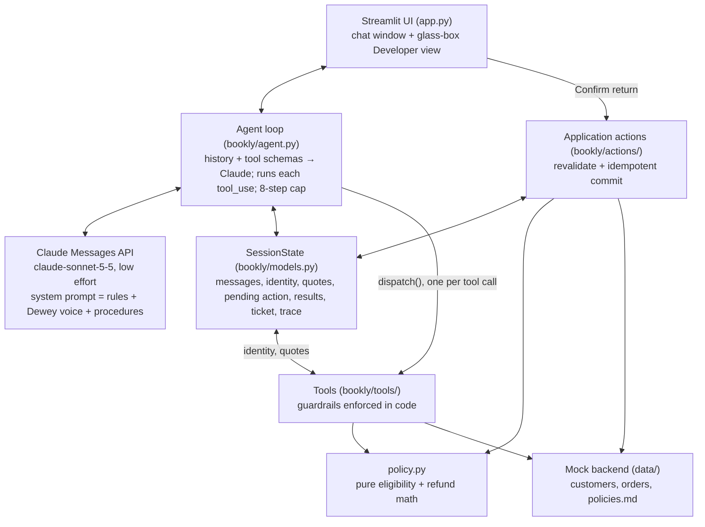

# Dewey: Bookly's bookworm support agent

A working prototype of a customer support agent for **Bookly**, a fictional online bookstore, built for the Decagon Solutions Engineering take-home. Dewey handles order status, returns and refunds, and store-policy questions, and hands anything else to a human.

**Thesis: playful in voice, precise in promises.** The LLM owns the conversation: understanding, tone, sequencing, and deciding when to ask a clarifying question. Plain Python owns every commitment: who the customer is, what's eligible, how much they get back, and whether an action actually happens. Dewey's personality lives only in the prompt and the UI, so it can never change what Bookly promises.

Built with the Anthropic Messages API (`claude-sonnet-5-5`) and a hand-written tool loop. No agent frameworks.

## Quickstart

Requires Python 3.11+.

```bash
python3 -m venv .venv && source .venv/bin/activate
pip install --upgrade pip && pip install -r requirements.txt
cp .env.example .env        # then add your ANTHROPIC_API_KEY
streamlit run app.py
```

Open the URL Streamlit prints (usually http://localhost:8501). There's also a terminal chat: `python -m bookly.cli`.

## Try it

Demo accounts are also listed in the app's Developer view.

| Customer | Email | ZIP | Try saying |
|---|---|---|---|
| Maya | maya.chen@example.com | 94110 | "Where's my order?" · "I'd like to return a book." |
| Daniel | daniel.okafor@example.com | 10027 | "I want to return Northern Lines." then "Can you make an exception?" |
| Priya | priya.raman@example.com | 60614 | "Where's my order?" · "My Cartographer's Daughter arrived with a torn cover." |
| anyone | none | none | "Do you ship to Canada?" · "Can I sell you my used books?" |

The Customer view is a small chat window. The Developer view is a **glass box**. It shows:
- what code has committed to (verified customer, quotes, RMAs, tickets)
- every LLM step and tool call, with full inputs and outputs

## How it meets the assignment

| Requirement | Where to see it |
|---|---|
| Multi-turn interaction that collects info first | Maya's return. Dewey verifies her, then asks for the item, the reason, and the refund method, and prepares an exact proposal. |
| Takes an action / uses a tool | The application-controlled **Confirm return** button issues an RMA. `escalate_to_human` opens a ticket. Six model-visible tools in total. |
| Asks a clarifying question instead of answering | Priya's "Where's my order?" She has two active orders, so Dewey asks which one. (Maya has one active order, so Dewey assumes it and says so.) |

## Architecture



- **Orchestration.** One agent and one loop in [`agent.py`](bookly/agent.py), about 150 lines including tracing:
  - It sends the history and tool schemas, runs every requested tool, and sends all results back in one message.
  - It repeats until Claude replies with `end_turn`.
  - Anything else (`max_tokens`, a refusal, hitting the step limit) never reaches the customer as a half-answer. It becomes a plain apology and a handoff ticket.
  - An API error mid-turn rolls the history back, so the next turn starts clean.
- **Tools.** Seven plain functions in [`bookly/tools/`](bookly/tools/), grouped by domain. Each schema sits right above its function, and `strict: true` guarantees inputs match the schema.
  - The customer's identity always comes from the session, never from tool arguments.
  - Tools never raise. A failure returns a customer-safe `message` and, when useful, a model-only `hint` for what to do next.
- **Memory.** Per session only, in two layers:
  - the append-only message history Claude sees
  - a typed `SessionState` that only code writes to

  Nothing persists between sessions, so no customer data is stored. Production would load context from the CRM at the start of a session.
- **Prompts.** Markdown files in [`bookly/prompts/`](bookly/prompts/), joined in order:
  - base rules
  - Dewey's voice
  - one procedure per intent

  A CX lead can read and edit them like a playbook. Hard rules live in the tools, so a bad prompt edit can't break policy.

## Key design decisions

**1. Policy lives in code, not in the prompt.**
- **Chose:** `policy.py` decides eligibility and computes every amount, and the tools enforce it. Dewey only states numbers a tool returned.
- **Traded off:** flexibility. Dewey can't "use judgment" to bend a rule, so exceptions go to a human.
- **Why:** a support agent that improvises refunds is a liability. With this split, the rules can be unit-tested without an LLM (16 policy tests).

**2. Confirm before commit, enforced in code.**
- **Chose:** `prepare_return` prices the return and stores an immutable pending action. The
  model cannot submit it: `submit_return` is absent from its tool registry. Streamlit renders
  the canonical details, and only the **Confirm return** button reaches the application action
  service. Confirmation rechecks identity, policy, items, and amounts before issuing an RMA.
- **Traded off:** the CLI can prepare proposals but cannot commit them; consequential actions
  require the UI (or a future authenticated application endpoint).
- **Why:** "ask before acting" in a prompt—even with a turn check—does not prove consent to the
  exact proposal. A control bound to an opaque pending-action token does. Confirmation is
  idempotent, so a retry cannot create a second return.

**3. Ask only when a wrong guess would cost the customer.**
- **Chose:** the procedures tell Dewey to act when only one reading fits (and say what it assumed), and ask when several readings fit and acting on the wrong one matters.
- **Traded off:** occasionally assuming wrong on low-stakes questions.
- **Why:** over-asking is the most common way support bots feel robotic. Maya's one active order is assumed; Priya's two are asked about.

## Assumptions

Every policy number lives in [`config.py`](bookly/config.py) and [`data/policies.md`](data/policies.md).

| Topic | Assumption |
|---|---|
| Authentication | The chat is unauthenticated; customers verify with email + ZIP before seeing order data. It locks after 3 failures. Production would use a signed-in session. |
| Today's date | Frozen at 2026-10-24 (`BOOKLY_TODAY`) so return-window math and the demo are reproducible. |
| Return window | Physical books: 30 days from delivery. Day 30 is eligible; day 31 is not. |
| Change-of-mind refund | Original payment minus a $4.99 label fee (once per return), or the full amount as store credit. |
| Damaged or wrong item | Within 30 days of delivery. Replacement or full refund, prepaid label, no fee. |
| Ebooks | Refundable within 7 days of purchase, only if never downloaded. |
| Preorders | Not returnable before delivery. Cancellations go to a human. |
| Shipping | US and Canada only. Standard 5–7 business days, free on $35+. Expedited 2–3 days, $9.99. |
| Out of scope | Cancellations, address changes, and lost packages escalate to a human (mock ticket, reply within 24 hours). |

## What I tuned

Found while running the demo scenarios against the live model:

| Problem | Fix |
|---|---|
| Dewey wrote dates as `2026-10-20` | Voice rule: dates the way people say them ("Oct 20"). |
| Daniel had to give a return reason and refund method before hearing his book was out of window | `get_order` now reports each item's returnability (decided by `policy.py`), so Dewey declines right away. |
| Dewey's voice was flat, with no bookish touches | Concrete example phrases and a "never two flourishes in a row" rule, borrowed from my earlier [Trailhead support agent](https://github.com/jilliangoldberg/retail-customer-service-agent). |
| "Payment methods" ranked the refunds policy above the payment policy | Policy search weights title matches. |
| Tool errors mixed customer wording with instructions for the model | Split into `message` (safe to say) and `hint` (only for the model). |

## Tests

```bash
python -m pytest
```

108 tests, no API key needed:
- [`test_policy.py`](tests/test_policy.py): return-window edges (day 30 vs 31), ebook rules, and refund math.
- [`test_tools.py`](tests/test_tools.py): the guardrails.
  - Wrong email and wrong ZIP look identical.
  - Verification locks after 3 failures.
  - Another customer's order looks like a missing one.
  - `submit_return` is not a model tool.
  - UI-authorized confirmation rechecks policy and is idempotent.
  - Uncovered topics return nothing.
  - Every tool schema is valid for strict mode.
- [`test_agent.py`](tests/test_agent.py): the loop, run against a scripted fake client.
  - Tool round trips, including parallel calls.
  - Rollback on API errors.
  - No partial replies on `max_tokens` or refusal.
  - The step limit.
  - A fabricated submit tool call cannot cross the application action boundary.
- [`test_app.py`](tests/test_app.py): the real Streamlit confirmation card.
  - Canonical book, order, and amount rendering.
  - Confirm creates the RMA; Cancel and Reset do not.
- [`test_evals.py`](tests/test_evals.py): the eval harness itself. Every scenario's reference run passes its graders, an empty run fails them, and each grader catches the failure it's for.

## Evals

Unit tests check code paths. The evals check whole conversations against the live model:

```bash
python -m evals list
python -m evals run --scenario S3 --trials 1 --no-judge   # quick wiring check
python -m evals run                                       # all scenarios, 5 trials each, with the judge
```

- **A simulated customer** (Sonnet 5.5) plays each scenario's persona and goal. It sees only what a real customer sees, and it can press the Confirm return and Cancel buttons.
- **Deterministic gates** check the end state (was the right return submitted, or none? was a ticket opened?), required and forbidden tools, other customers' data, amounts no tool returned, and claims of actions that never happened. Any gate failure fails the trial.
- **A judge on a different model** (Opus 5.5) grades grounding, clarification, authorization, resolution, tone, and whether the simulated customer stayed in character. A trial where the customer broke script is marked invalid, not failed.
- **The scorecard** reports pass@1 and pass^k (all k trials pass) per scenario, plus cost. Each trial is also saved as a readable transcript under `evals/results/`.
- **Calibration:** `python -m evals calibrate` compares the judge with human labels in `evals/labels.jsonl`.

**Watch a scenario in the UI.** In the app's Developer view, *Eval scenarios* lists every scenario with its latest saved result:
- **Load** replays a saved run (`evals/showcase/`) through the real tools and puts it in the chat window. It's free and instant, the session state and trace fill in, and you can keep chatting from where it ended. The Developer view shows how that run was graded.
- **Run live** plays a fresh simulated customer against the model (about $0.04, gates only).

Refresh the saved runs after an eval pass with `python -m evals showcase evals/results/<run>` (it skips any run that no longer replays identically).

Evals call the API and cost money; they never run in pytest. A gates-only trial costs about $0.04.

## Limitations and next steps

1. **Finish the eval baseline.** Run the full suite with the judge, calibrate the judge against human labels, then record pass@1 and pass^5 for every scenario.
2. **Check replies before they're sent.** Every amount, date, order id, and RMA in a draft reply must appear in this session's tool results. A failing draft gets one constrained rewrite, then a safe fallback.
3. **Real integrations and authentication.** Replace the mock data with order-system and CRM APIs, and email + ZIP with a signed-in session. Production traces would be redacted; this demo shows everything on purpose.
4. **Scaling to more intents.** Load procedures and tools only when their topic comes up, instead of sending all of them on every call.
5. **Voice.** Streaming plus speech-to-text and text-to-speech, once the text agent is measured.

## How I used AI tools

I designed the thesis, scope, persona, and key decisions, then built this with Claude Code: planning, implementation, tests, and live scenario checks, milestone by milestone. [`DESIGN.md`](DESIGN.md) records the decisions and tradeoffs as they were made.
